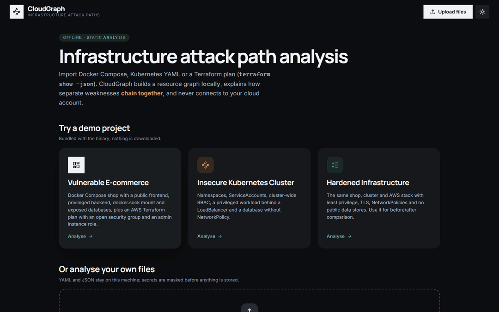
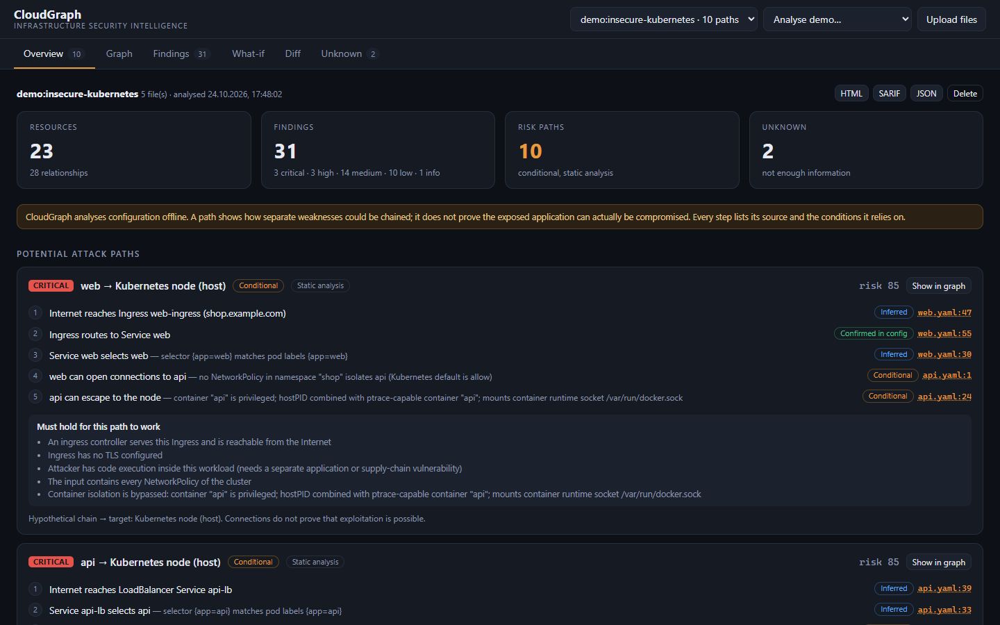
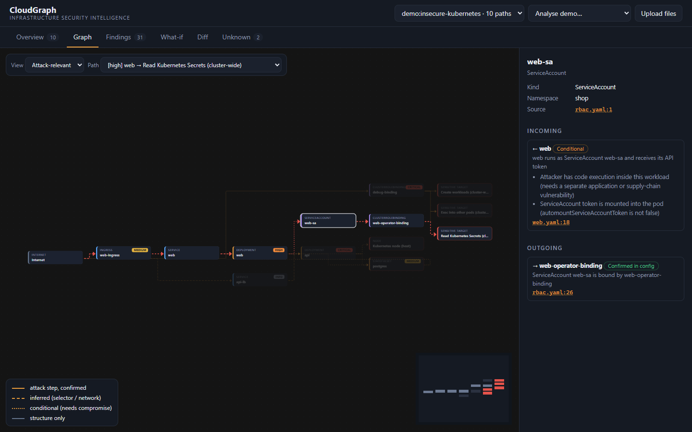
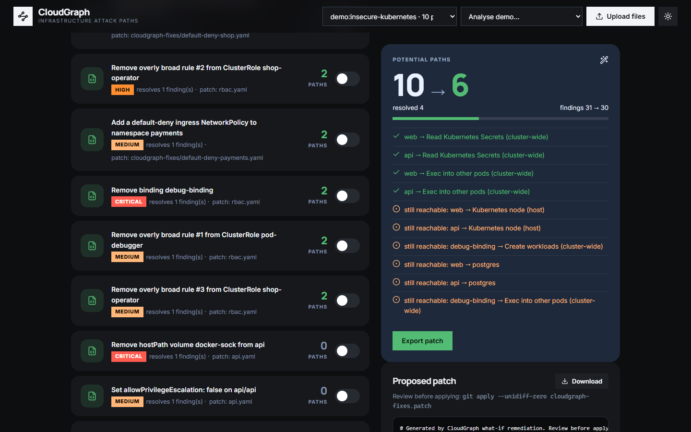

# CloudGraph: Infrastructure Attack Path Analysis

[](https://github.com/TroubieD3v/CloudGraph/actions/workflows/ci.yml)
[](LICENSE)


**English** · [Русский](README.ru.md)

CloudGraph is an open-source, **offline** engine that explains how separate security problems in your
infrastructure configuration can chain into a dangerous **attack path**. It reads Docker Compose, Kubernetes YAML
and Terraform plan JSON, builds a directed graph of resources, permissions and network reachability, and searches
it for routes from the Internet to sensitive targets: secrets, the host, cluster-admin rights, cloud accounts and
data stores. It never connects to a cloud account or a cluster.

It does not stop at "this container is privileged". It reports *"if the exposed web app is compromised, the token
of its ServiceAccount can read every Secret in the cluster"*, with every step traced to a file and line, the
conditions each step relies on, and the fix that breaks the most chains.

> **Note**: a path is **conditional**. CloudGraph shows which preconditions must hold; it never claims that an
> application can actually be exploited. Where the input is incomplete it reports **Unknown** instead of guessing a
> connection. See [SECURITY.md](SECURITY.md) and the [threat model](docs/threat-model.md).



*The insecure Kubernetes demo: ten conditional paths, one highlighted in the graph, a single what-if fix that
removes four of them, and a diff against the hardened version.*



| Graph with an explained path | What-if fix and patch |
|---|---|
|  |  |

## Modules

| Module | Does |
|---|---|
| Infrastructure Import | Docker Compose, Kubernetes YAML (multi-document, `List`), Terraform plan JSON from `terraform show -json`, including modules |
| Resource Discovery | Containers, services, networks, ports, volumes, secrets, ServiceAccounts, roles, bindings, security groups, IAM, S3, RDS |
| Graph Engine | Directed graph; every edge has a source line, a confidence level and the conditions it depends on |
| Security Rules | [41 rules](docs/RULES.md) for Compose, Kubernetes (including RBAC and NetworkPolicy) and AWS Terraform |
| Attack Path Engine | Routes from an Internet-reachable entry to a sensitive target, with prerequisites and a risk score |
| Risk Prioritization | Score = target impact × path confidence; shared choke points that break several paths at once |
| Remediation Studio | Source viewer with masked secrets, remediation text, a `git apply`-able patch |
| What-if Simulator | Applies fixes to a virtual copy, recomputes the graph and shows which paths disappear |
| Infrastructure Diff | Compares two states by relationships, findings and paths, not just by counts |
| Reporting & CI | Terminal, JSON, HTML, SARIF 2.1.0 (paths as `codeFlows`), exit codes for pipelines |

### How confident is an edge

| Level | Meaning | Example |
|---|---|---|
| confirmed | Stated explicitly in the configuration | `serviceAccountName: web-sa`, a port published on `0.0.0.0` |
| inferred | Derived by evaluating semantics | a label selector match, a shared Docker network, NetworkPolicy evaluation |
| conditional | Holds only if an attacker precondition is met | using a pod's token *after* compromising the pod, a container escape |
| unknown | The input does not say; never traversed | an Ingress pointing to a Service that is not in the input, an `ipBlock` peer |

A path is reported only when it starts at an Internet-reachable entry, ends at a sensitive target and contains at
most one network pivot, so the normal frontend → backend → database architecture is not reported as a risk.
When several routes lead through the same resources to the same target, CloudGraph keeps the best supported one:
the route whose weakest step is strongest wins, then the one with fewer unconfirmed steps, and only then the shorter
one. A short route that needs an extra assumption never hides a longer route that the configuration confirms.

### Search limits

| Limit | Default | Flag / API field | When it is reached |
|---|---|---|---|
| Path depth | 10 edges (max 20) | `--max-depth` / `maxDepth` | **Incomplete analysis** warning: some routes were not followed to the end |
| Candidate paths | 20 000 (max 200 000) | `--max-paths` / `maxCandidates` | **Incomplete analysis** warning: the search stopped early |
| Network pivots per path | 1 (max 3) | `--max-pivots` / `maxPivots` | Scope note: multi-pivot chains were deliberately not followed |

The limits and their outcome are recorded with every analysis and shown in the terminal, the HTML report, the
web UI and SARIF (`invocations[].toolExecutionNotifications`, plus `runs[].properties.pathSearch`). A what-if
simulation reuses the limits of the analysis it starts from, so it never "resolves" a path it simply did not search.
`--fail-incomplete` turns a truncated search into exit code 1 for pipelines that must not pass on partial results.

## Workflow

1. **Import**: point the CLI at a directory, or upload files in the web UI. Helm and Kustomize must be rendered
   first (`helm template`, `kustomize build`); Terraform needs `terraform show -json plan.out`.
2. **Read the paths**: each one lists its steps, their confidence, the source line and the preconditions.
3. **Explore the graph**: highlight a path, click a node or an edge to see why it exists.
4. **Simulate fixes**: tick one or more fixes, watch the paths that disappear, export the patch.
5. **Compare** two states (before/after a change, vulnerable vs hardened) and gate CI on new findings.

The interface has six views: Overview, Graph, Findings, What-if, Diff and Unknown.

## Quick start (Docker)

Prefer a single binary? Download it for Linux, macOS or Windows from
[Releases](https://github.com/TroubieD3v/CloudGraph/releases/latest) and run `cloudgraph serve`. With Docker:

```bash
git clone https://github.com/TroubieD3v/CloudGraph.git
cd CloudGraph
docker build -t cloudgraph .
docker run --rm -p 127.0.0.1:8080:8080 -v cloudgraph-data:/data cloudgraph
```

Open <http://127.0.0.1:8080> and pick a demo project. The port is published on the loopback interface only.
History is kept in the `cloudgraph-data` volume; `docker volume rm cloudgraph-data` deletes it.

Bundled demo projects:

| Demo | Story |
|---|---|
| Vulnerable E-commerce | Compose shop: public frontend, privileged backend with `docker.sock`, published databases, plus an AWS plan with an open security group and an admin instance role |
| Insecure Kubernetes Cluster | Namespaces, ServiceAccounts, cluster-wide RBAC, a privileged workload behind a LoadBalancer, a database without NetworkPolicy |
| Hardened Infrastructure | The same stack, fixed: zero findings, zero paths; use it for diffs |

**Troubleshooting**

- *Port 8080 already in use*: `docker run --rm -p 127.0.0.1:8090:8080 cloudgraph`, then open port 8090.
- *Upload says "no supported resources found"*: the files are not Compose, Kubernetes or a Terraform **plan** JSON
  (state files and HCL are not read). Templated manifests must be rendered first.
- *A connection you expected is missing*: open the **Unknown** view; it lists every reference the input could not
  resolve.

## Local development (no Docker)

Requires Go 1.27+ and Node.js 22+.

```bash
make build                            # UI into internal/ui/dist/app, then bin/cloudgraph
./bin/cloudgraph serve                # UI + API on 127.0.0.1:8080
cd web && npm run dev                 # optional: UI with hot reload on :5173 (proxies /api to :8080)
```

Without `make`: `npm --prefix web ci && npm --prefix web run build && go build -o bin/cloudgraph ./cmd/cloudgraph`.

## Command line and CI

```bash
cloudgraph scan ./infrastructure                                   # paths, findings, unknowns in the terminal
cloudgraph scan ./infrastructure --format sarif --output results.sarif --fail-on high
cloudgraph simulate ./k8s --list                                   # how many paths each fix resolves
cloudgraph simulate ./k8s --all --patch fixes.patch                # proposed patch, then: git apply --unidiff-zero fixes.patch
cloudgraph diff ./before ./after
cloudgraph scan demo:insecure-kubernetes --format html --output report.html
```

Exit codes: `0` ok, `1` a finding at or above `--fail-on` (or a truncated search with `--fail-incomplete`),
`2` error. GitHub Code Scanning shows the SARIF findings and the attack paths as code flows:

```yaml
- run: cloudgraph scan ./infrastructure --format sarif --output results.sarif --fail-on high
- uses: github/codeql-action/upload-sarif@v4
  if: always()
  with:
    sarif_file: results.sarif
```

The `scan-examples` job in [ci.yml](.github/workflows/ci.yml) runs exactly this on the hardened project, and then
scans the intentionally vulnerable projects: the gate must fail with exit code 1, and the SARIF must validate against
the SARIF 2.1.0 schema and contain the expected findings and attack paths ([scripts/check_sarif.py](scripts/check_sarif.py)).

## Safety

- Offline: CloudGraph reads files. It never calls a cloud API, a cluster or the Internet.
- Secrets are masked **at import**: environment values, credentials in URLs, Terraform `sensitive_values`,
  Kubernetes Secret data. Masking happens before anything is stored, logged, exported or shown in the source viewer.
- What-if never touches your files; patches are exported for review.
- The server binds to `127.0.0.1`, has no authentication by design, rejects cross-origin writes and non-JSON posts,
  and sends a restrictive Content Security Policy.
- Untrusted configuration is fuzzed: self-referencing YAML anchors and corrupted inputs must not crash the engine.

## Tests

```bash
go vet ./... && go test ./...           # 64 test functions: parsers, graph semantics, rules, paths and limits, what-if, API, CLI
npm --prefix web run build
npm --prefix web run test:e2e           # 14 Playwright tests; PW_CHANNEL=chrome reuses an installed Chrome
go test ./internal/analyze -run '^$' -fuzz FuzzAnalyze -fuzztime 60s
```

Every rule must fire on a vulnerable example, and the hardened project must produce zero findings and zero paths.
Graph tests prove that missing information becomes Unknown instead of an invented edge. The exported patch is
applied to the demo files and re-scanned, and the result must match the what-if prediction. A dedicated test
checks that no planted secret ever appears in JSON, SARIF, HTML, terminal output, patches or the source viewer.

`docs/RULES.md` is generated with `cloudgraph rules --format markdown`; a test fails when it is stale.
`web/scripts/screenshots.mjs` and `web/scripts/make_gif.py` regenerate the screenshots in this README.

## Architecture

```
Compose / Kubernetes / Terraform plan ──► parse (lines kept, secrets masked) ──► inventory
inventory ──► graph (edges + confidence + conditions) ──► rules (findings + fixes) ──► paths (score, hotspots)
analysis ──► CLI · REST API + SQLite history · React UI (@xyflow/react) · JSON / HTML / SARIF
what-if: clone inventory ──► apply fixes ──► rerun everything ──► compare
```

- `cmd/cloudgraph/`: CLI and server entry point; one static binary with the UI and demos embedded.
- `internal/parse/`: importers; `internal/graph/`: relationships, RBAC and NetworkPolicy semantics.
- `internal/rules/`: the rules; `internal/paths/`: path search and scoring.
- `internal/analyze/`: pipeline, what-if, patch export, diff; `internal/report/`: output formats.
- `internal/server/`, `internal/store/`: REST API and SQLite snapshots; `internal/mask/`: secret masking.
- `web/`: React + TypeScript + Vite, Playwright tests. `examples/`: the demo projects.

Details: [docs/architecture.md](docs/architecture.md) · [docs/threat-model.md](docs/threat-model.md) ·
[docs/RULES.md](docs/RULES.md) · [CONTRIBUTING.md](CONTRIBUTING.md) · [CHANGELOG.md](CHANGELOG.md).

## Roadmap

More Terraform providers (GCP, Azure) and AWS services (EKS, Lambda, load balancers), Helm and Kustomize rendering
built in, Kubernetes admission objects (PodSecurity labels), and runtime context imported from existing scanners.

## Releases

| Version | Result |
|---|---|
| **v0.1.0** | **Compose, Kubernetes and Terraform import, 41 rules, attack paths, what-if with patch export, diff, SARIF, web UI, Docker** |

Pushing a `v*` tag builds static binaries for Linux, macOS and Windows with checksums
([release.yml](.github/workflows/release.yml)).

## License

[MIT](LICENSE)
