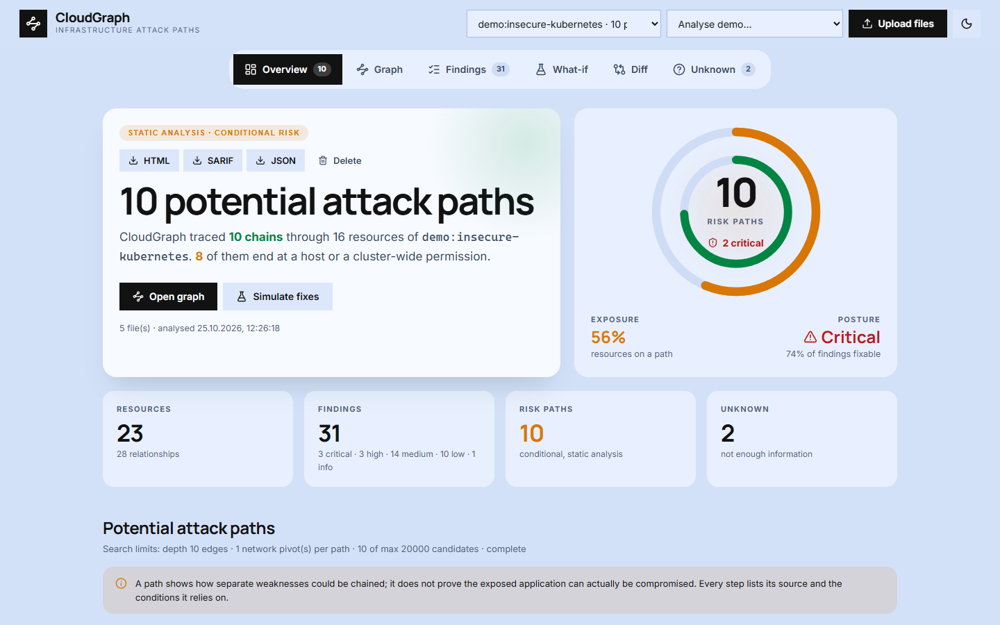

# CloudGraph: анализ путей атаки в инфраструктуре

[](https://github.com/TroubieD3v/CloudGraph/actions/workflows/ci.yml)
[](LICENSE)


[English](README.md) · **Русский**

CloudGraph — open-source движок, который **без подключения к облаку** объясняет, как отдельные проблемы в
конфигурации инфраструктуры складываются в опасный **путь атаки**. Он читает Docker Compose, Kubernetes YAML и
Terraform plan JSON, строит направленный граф ресурсов, прав и сетевой достижимости и ищет в нём маршруты из
Интернета к чувствительным целям: секретам, хосту, правам cluster-admin, облачному аккаунту и хранилищам данных.
К облачным аккаунтам и кластерам CloudGraph не обращается.

Он не останавливается на «этот контейнер привилегированный». Отчёт звучит так: *«если открытое веб-приложение
будет скомпрометировано, токен его ServiceAccount позволит читать все Secret в кластере»* — каждый шаг привязан к
файлу и строке, у каждого перечислены условия, а рядом показано исправление, которое разрывает больше всего цепочек.

> **Важно**: путь **условный**. CloudGraph показывает, какие предпосылки должны выполниться, и никогда не
> утверждает, что приложение действительно можно взломать. Если данных не хватает, он сообщает **Unknown**, а не
> придумывает связь. См. [SECURITY.md](SECURITY.md) и [модель угроз](docs/threat-model.md).


*Демо небезопасного кластера Kubernetes: десять условных путей, один из них подсвечен в графе, одно виртуальное
исправление убирает четыре пути, затем сравнение с защищённой версией.*


| Граф с объяснённым путём | What-if и патч |
|---|---|
|  |  |

## Модули

| Модуль | Что делает |
|---|---|
| Infrastructure Import | Docker Compose, Kubernetes YAML (несколько документов, `List`), Terraform plan JSON из `terraform show -json`, включая модули |
| Resource Discovery | Контейнеры, сервисы, сети, порты, тома, секреты, ServiceAccount, роли, привязки, security groups, IAM, S3, RDS |
| Graph Engine | Направленный граф; у каждого ребра есть строка-источник, уровень уверенности и условия |
| Security Rules | [41 правило](docs/RULES.md) для Compose, Kubernetes (включая RBAC и NetworkPolicy) и AWS Terraform |
| Attack Path Engine | Маршруты от точки входа, доступной из Интернета, до чувствительной цели, с предпосылками и оценкой риска |
| Risk Prioritization | Оценка = ущерб от цели × уверенность пути; общие узкие места, исправление которых рвёт сразу несколько путей |
| Remediation Studio | Просмотр конфигурации с замаскированными секретами, рекомендации, патч для `git apply` |
| What-if Simulator | Применяет исправления к виртуальной копии, пересчитывает граф и показывает, какие пути исчезли |
| Infrastructure Diff | Сравнивает два состояния по связям, находкам и путям, а не только по количеству |
| Reporting & CI | Терминал, JSON, HTML, SARIF 2.1.0 (пути как `codeFlows`), коды выхода для пайплайнов |

### Насколько уверено ребро

| Уровень | Значение | Пример |
|---|---|---|
| confirmed | Явно указано в конфигурации | `serviceAccountName: web-sa`, порт опубликован на `0.0.0.0` |
| inferred | Выведено из семантики | совпадение label selector, общая сеть Docker, вычисление NetworkPolicy |
| conditional | Верно только при выполнении предпосылки атакующего | токен пода *после* компрометации пода, побег из контейнера |
| unknown | Во входных данных этого нет; по таким рёбрам не ходим | Ingress ссылается на отсутствующий Service, пир `ipBlock` |

Путь попадает в отчёт, только если он начинается в точке входа, доступной из Интернета, заканчивается на
чувствительной цели и содержит не больше одного сетевого «прыжка». Поэтому обычная архитектура frontend → backend →
база данных не считается риском. Если к одной цели через одни и те же ресурсы ведут несколько маршрутов, CloudGraph
оставляет самый обоснованный: сначала тот, у которого самый слабый шаг сильнее, затем тот, где меньше неподтверждённых
шагов, и только потом более короткий. Короткий маршрут с лишним допущением не вытесняет более длинный, но
подтверждённый конфигурацией.

### Ограничения поиска

| Ограничение | По умолчанию | Флаг / поле API | Что происходит при достижении |
|---|---|---|---|
| Глубина пути | 10 рёбер (максимум 20) | `--max-depth` / `maxDepth` | Предупреждение **Incomplete analysis**: часть маршрутов не прослежена до конца |
| Кандидаты путей | 20 000 (максимум 200 000) | `--max-paths` / `maxCandidates` | Предупреждение **Incomplete analysis**: поиск остановлен досрочно |
| Сетевые «прыжки» в пути | 1 (максимум 3) | `--max-pivots` / `maxPivots` | Пометка об области анализа: цепочки с несколькими прыжками сознательно не прослеживаются |

Ограничения и их итог сохраняются вместе с каждым анализом и показываются в терминале, HTML-отчёте, веб-интерфейсе и
SARIF (`invocations[].toolExecutionNotifications`, а также `runs[].properties.pathSearch`). Симуляция what-if
использует ограничения исходного анализа, поэтому никогда не «устраняет» путь, который просто не искали.
`--fail-incomplete` превращает неполный поиск в код выхода 1 для пайплайнов, которые не должны проходить на частичном
результате.

## Как пользоваться

1. **Импорт**: укажите CLI каталог или загрузите файлы в веб-интерфейсе. Helm и Kustomize нужно сначала отрендерить
   (`helm template`, `kustomize build`); для Terraform нужен `terraform show -json plan.out`.
2. **Пути**: у каждого — шаги, их уверенность, строка-источник и предпосылки.
3. **Граф**: подсветите путь, кликните по узлу или ребру, чтобы увидеть, откуда взялась связь.
4. **Симуляция исправлений**: отметьте исправления, посмотрите, какие пути исчезли, выгрузите патч.
5. **Сравнение** двух состояний (до/после изменения, уязвимое и защищённое) и проверка в CI на новые находки.

В интерфейсе шесть разделов: Overview, Graph, Findings, What-if, Diff и Unknown. По умолчанию он открывается в тёмной
теме; кнопка с солнцем/луной в верхней панели переключает на светлую и запоминает выбор. Шрифты и иконки встроены, поэтому
интерфейсу не нужен доступ в Интернет.



## Быстрый старт (Docker)

Удобнее один бинарник? Скачайте его для Linux, macOS или Windows на странице
[Releases](https://github.com/TroubieD3v/CloudGraph/releases/latest) и запустите `cloudgraph serve`. С Docker:

```bash
git clone https://github.com/TroubieD3v/CloudGraph.git
cd CloudGraph
docker build -t cloudgraph .
docker run --rm -p 127.0.0.1:8080:8080 -v cloudgraph-data:/data cloudgraph
```

Откройте <http://127.0.0.1:8080> и выберите демо-проект. Порт опубликован только на loopback-интерфейсе. История
хранится в томе `cloudgraph-data`; `docker volume rm cloudgraph-data` удаляет её.

Демо-проекты:

| Демо | Сюжет |
|---|---|
| Vulnerable E-commerce | Магазин на Compose: публичный frontend, привилегированный backend с `docker.sock`, открытые базы данных и AWS-план с открытой security group и админской ролью инстанса |
| Insecure Kubernetes Cluster | Namespaces, ServiceAccount, RBAC на весь кластер, привилегированная нагрузка за LoadBalancer, база без NetworkPolicy |
| Hardened Infrastructure | Тот же стек после исправлений: ноль находок и ноль путей; для сравнения |

**Если что-то не так**

- *Порт 8080 занят*: `docker run --rm -p 127.0.0.1:8090:8080 cloudgraph`, затем откройте порт 8090.
- *Загрузка пишет «no supported resources found»*: файлы не Compose, не Kubernetes и не Terraform **plan** JSON
  (state-файлы и HCL не читаются). Шаблонные манифесты нужно сначала отрендерить.
- *Нет ожидаемой связи*: откройте раздел **Unknown** — там перечислено всё, что не удалось разрешить по входным данным.

## Локальная разработка (без Docker)

Нужны Go 1.27+ и Node.js 22+.

```bash
make build                            # интерфейс в internal/ui/dist/app, затем bin/cloudgraph
./bin/cloudgraph serve                # интерфейс и API на 127.0.0.1:8080
cd web && npm run dev                 # по желанию: интерфейс с hot reload на :5173 (проксирует /api на :8080)
```

Без `make`: `npm --prefix web ci && npm --prefix web run build && go build -o bin/cloudgraph ./cmd/cloudgraph`.

## Командная строка и CI

```bash
cloudgraph scan ./infrastructure                                   # пути, находки, Unknown в терминале
cloudgraph scan ./infrastructure --format sarif --output results.sarif --fail-on high
cloudgraph simulate ./k8s --list                                   # сколько путей убирает каждое исправление
cloudgraph simulate ./k8s --all --patch fixes.patch                # предлагаемый патч, затем: git apply --unidiff-zero fixes.patch
cloudgraph diff ./before ./after
cloudgraph scan demo:insecure-kubernetes --format html --output report.html
```

Коды выхода: `0` всё в порядке, `1` есть находка уровня `--fail-on` или выше (или поиск неполный при
`--fail-incomplete`), `2` ошибка. GitHub Code Scanning
показывает находки из SARIF, а пути атаки — как code flows:

```yaml
- run: cloudgraph scan ./infrastructure --format sarif --output results.sarif --fail-on high
- uses: github/codeql-action/upload-sarif@v4
  if: always()
  with:
    sarif_file: results.sarif
```

Именно так задача `scan-examples` в [ci.yml](.github/workflows/ci.yml) проверяет защищённый проект, а затем сканирует
намеренно уязвимые: проверка обязана упасть с кодом 1, а SARIF — пройти валидацию по схеме SARIF 2.1.0 и содержать
ожидаемые находки и пути атаки ([scripts/check_sarif.py](scripts/check_sarif.py)).

## Безопасность

- Офлайн: CloudGraph читает файлы и никогда не обращается к облачному API, кластеру или Интернету.
- Секреты маскируются **при импорте**: значения переменных окружения, учётные данные в URL, Terraform
  `sensitive_values`, данные Kubernetes Secret. Маскирование происходит до сохранения, логирования, экспорта и показа
  в просмотре конфигурации.
- What-if никогда не меняет ваши файлы; патч выгружается для проверки.
- Сервер слушает `127.0.0.1`, намеренно не имеет аутентификации, отклоняет межсайтовые запросы на запись и не-JSON
  запросы и отдаёт строгую Content Security Policy.
- Недоверенная конфигурация проверяется фаззингом: самоссылающиеся YAML-якоря и испорченные файлы не должны ронять движок.

## Тесты

```bash
go vet ./... && go test ./...           # 64 тестовые функции: импорт, семантика графа, правила, пути и лимиты, what-if, API, CLI
npm --prefix web run build
npm --prefix web run test:e2e           # 14 тестов Playwright; PW_CHANNEL=chrome использует установленный Chrome
go test ./internal/analyze -run '^$' -fuzz FuzzAnalyze -fuzztime 60s
```

Каждое правило должно срабатывать на уязвимом примере, а защищённый проект — давать ноль находок и ноль путей. Тесты
графа доказывают, что недостающие данные превращаются в Unknown, а не в придуманное ребро. Выгруженный патч
накладывается на демо-файлы, они сканируются заново, и результат должен совпасть с прогнозом what-if. Отдельный тест
проверяет, что ни один заложенный секрет не попадает в JSON, SARIF, HTML, вывод терминала, патчи и просмотр конфигурации.

`docs/RULES.md` генерируется командой `cloudgraph rules --format markdown`; тест падает, если файл устарел.
`web/scripts/screenshots.mjs` и `web/scripts/make_gif.py` пересоздают скриншоты для README.

## Архитектура

```
Compose / Kubernetes / Terraform plan ──► импорт (строки сохраняются, секреты маскируются) ──► инвентарь
инвентарь ──► граф (рёбра + уверенность + условия) ──► правила (находки + исправления) ──► пути (оценка, узкие места)
анализ ──► CLI · REST API + история в SQLite · интерфейс React (@xyflow/react) · JSON / HTML / SARIF
what-if: копия инвентаря ──► исправления ──► полный пересчёт ──► сравнение
```

- `cmd/cloudgraph/`: CLI и сервер; один статический бинарник со встроенными интерфейсом и демо.
- `internal/parse/`: импорт; `internal/graph/`: связи, семантика RBAC и NetworkPolicy.
- `internal/rules/`: правила; `internal/paths/`: поиск и оценка путей.
- `internal/analyze/`: конвейер, what-if, экспорт патча, сравнение; `internal/report/`: форматы отчётов.
- `internal/server/`, `internal/store/`: REST API и снимки в SQLite; `internal/mask/`: маскирование секретов.
- `web/`: React + TypeScript + Vite, тесты Playwright. `examples/`: демо-проекты.

Подробности: [docs/architecture.md](docs/architecture.md) · [docs/threat-model.md](docs/threat-model.md) ·
[docs/RULES.md](docs/RULES.md) · [CONTRIBUTING.md](CONTRIBUTING.md) · [CHANGELOG.md](CHANGELOG.md).

## Планы

Другие провайдеры Terraform (GCP, Azure) и сервисы AWS (EKS, Lambda, балансировщики), встроенный рендеринг Helm и
Kustomize, объекты допуска Kubernetes (метки PodSecurity) и импорт runtime-контекста из существующих сканеров.

## Релизы

| Версия | Результат |
|---|---|
| v0.1.0 | Импорт Compose, Kubernetes и Terraform, 41 правило, пути атаки, what-if с экспортом патча, сравнение, SARIF, веб-интерфейс, Docker |
| **v0.2.0** | **Новый дизайн интерфейса: новая палитра и шрифты, тёмная тема по умолчанию с переключателем светлой, встроенные шрифты и иконки, обновлённый HTML-отчёт** |

Тег `v*` запускает сборку статических бинарников для Linux, macOS и Windows с контрольными суммами
([release.yml](.github/workflows/release.yml)).

## Лицензия

[MIT](LICENSE)
